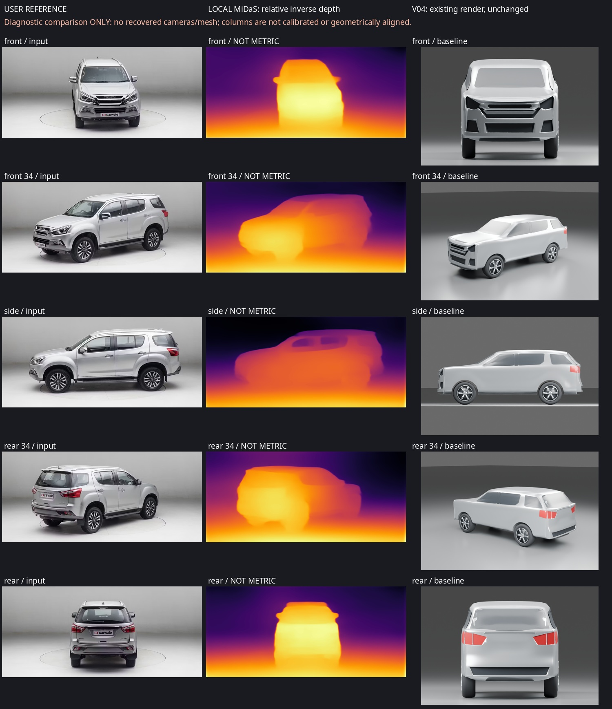

# ISUZU MU-X — Free local reconstruction experiment

Date: 2026-11-07. Cost: **₹0 / $0**. External vehicle geometry: **NONE**. No reference uploads, paid API, SaaS, cloud GPU, production export, integration, deployment or Git commit.

## Decision

**LEVEL C — WEAK.** CPU SfM failed to establish any sparse model. A genuinely local neural fallback generated five relative inverse-depth maps, but visual inspection found no material improvement in the missing MU-X geometry. Do not use them for shrinkwrapping or measured cross-sections.

**C — CURRENT IMAGE SET CANNOT PROVIDE BETTER GEOMETRY; NEW CONTROLLED PHOTOS REQUIRED**

This decision applies to the tested CPU workflow on this machine. It is not proof that every untested generative algorithm would fail. GPU methods were audited, not benchmarked. Their potential output would also need reference-based validation.

V04 remains the manual baseline, not an approved production MU-X. No V05 was created.

## Hardware and existing software

- Intel Core i5-7400T @ 2.40 GHz, four cores/four threads, AVX2.
- RAM 7.7 GiB; available approximately 3.0–3.4 GiB during audit. Swap 19 GiB, approximately 3.1–3.2 GiB used.
- Intel Kaby Lake-S GT2 / HD Graphics 630 integrated GPU. Shared system memory; no dedicated VRAM figure established. Graphics-device access was not exposed to the ordinary process. No NVIDIA/AMD accelerator appeared in PCI inventory.
- `nvidia-smi`, `nvcc` and `rocminfo`: command not found. CUDA/ROCm version: not available. Both actual trials explicitly used CPU.
- Home disk 484 GiB with approximately 309–310 GiB free. `/tmp` is a 3.9 GiB tmpfs, not a suitable destination for huge model installations.
- `blender --version`: success, **Blender 5.2.2 LTS**. Exact path `/usr/bin/blender`. No modeling or Blender save was performed.
- Python 3.14.7; NumPy and Pillow already available. Base Python lacked PyTorch, OpenCV, PyCOLMAP, Open3D, Trimesh, SciPy, Transformers, Diffusers and Nerfstudio. COLMAP CLI, OpenMVG, OpenMVS, Meshroom/AliceVision, `ns-train` and Instant-NGP executables were not found. No reconstruction-specific bundled Blender add-on was identified. This checks known entry points, not every possible user installation directory.

Raw observations: `reconstruction-local/logs/hardware-software.json`.

An isolated environment was created at `/home/thunder/Documents/Codex/mux-reconstruction-env`. Only official PyPI binary wheels for PyCOLMAP 4.2.1 and OpenCV-headless 5.0.0.93 were installed. Existing NumPy/Pillow were reused. No PyTorch, CUDA stack or large diffusion checkpoint was installed. Package versions and license notices are preserved in `logs/environment-freeze.txt`, `logs/package-licenses.json` and `logs/licenses/`.

## Current local-tool audit and method ranking

Official sources were checked rather than using third-party vehicle repositories. Installation burdens below are qualitative, not measured disk benchmarks. Models infer unseen surfaces; neither popularity nor a successful export establishes MU-X fidelity.

| Candidate | License and official source | Inputs / multiview | Hardware and installation | Output / suitability |
|---|---|---|---|---|
| **METHOD 1 — PyCOLMAP CPU SfM** | [COLMAP](https://colmap.github.io/pycolmap/index.html), [BSD-3-Clause](https://raw.githubusercontent.com/colmap/colmap/main/COPYING.txt); dependency notices retained | Overlapping photos; true camera/point recovery | CPU wheel available; small isolated install; used two threads | Cameras/sparse points. MVS requires valid poses first. Best measurable low-cost test of whether these photos support reconstruction. Tested; failed registration. |
| **METHOD 2 — MiDaS v2.1 small ONNX** | [Official ONNX workflow](https://github.com/isl-org/MiDaS/blob/master/tf/README.md), MIT | One RGB image at a time; no joint multiview conditioning | CPU OpenCV-DNN; 66,764,249-byte official checkpoint; no Torch installation | Relative inverse depth, not mesh or textured model. Tested only as lightweight neural shape-evidence fallback. |
| **METHOD 3 — TripoSR optional feasibility candidate** | [Official repository](https://github.com/VAST-AI-Research/TripoSR), MIT code/weights | Single image; multiple supplied files generate separate objects, not a jointly constrained model | Default about 6 GB VRAM; [official runner](https://github.com/VAST-AI-Research/TripoSR/blob/main/run.py) has CPU fallback. Torch, weights and meshing dependencies are a much larger installation | Mesh with vertex colors or optional baked texture. CPU execution is possible in principle, not proven practical here. Not installed/tested given limited available RAM and lack of true multiview constraints. |
| Hunyuan3D-2 / **2mv** | [Official repository](https://github.com/Tencent-Hunyuan/Hunyuan3D-2), [2mv model card](https://huggingface.co/tencent/Hunyuan3D-2mv), [custom community license](https://github.com/Tencent-Hunyuan/Hunyuan3D-2/blob/main/LICENSE) | 2mv supports named front/left/back images | Project advertises roughly 6 GB VRAM for shape, 16 GB shape plus texture; exact 2mv peak not measured. Torch/custom renderer/large weights | Mesh; separate texture pipeline. More suitable input interface, unavailable supported accelerator here. Custom license includes territorial/use conditions; not equivalent to MIT. Not installed or used. |
| TRELLIS.2 | [Official repository](https://github.com/microsoft/TRELLIS.2), MIT code/model with separate dependency terms | Image-conditioned generation; arbitrary joint multiview support not established by audited README | Linux, NVIDIA GPU with at least 24 GB memory, CUDA toolkit/custom dependencies; very high installation burden | Textured PBR meshes. Hardware mismatch; not downloaded/tested. |

NeRF/Gaussian-splatting workflows were not installed: this dataset did not yield trusted camera poses, and no supported CUDA accelerator was available. They do not remove the need for consistent observations. No claim is made that their output was tested. Other conventional SfM/MVS packages were unnecessary once the bounded registration test failed; dense reconstruction was deliberately not started.

Used-tool license records: PyCOLMAP BSD-3-Clause, OpenCV wheel Apache-2.0 plus bundled third-party notices, NumPy's installed multi-license expression, Pillow MIT-CMU, MiDaS MIT. MiDaS model came from the [official release](https://github.com/isl-org/MiDaS/releases/download/v2_1/model-small.onnx); local SHA-256 `2d8c6cb8f415229daf1eb041024208e2608c9f98e17c81cc7c6ecb449c56fd58` is a recorded fingerprint, not a claimed upstream signed checksum. License/origin/weights retained under `reconstruction-local/models/`. No MU-X geometry was downloaded.

## Dataset audit

The existing authoritative inventory was reused. Original images were not edited. The silver open-panel family remains the canonical identity reference; closed-panel screenshots of the matching older body family were used for this closed-body test. Open panels were not mixed into SfM. Paint color alone was not a rejection criterion; vehicle generation, trim, camera continuity and correspondence were.

Original images: **18**. Exclusive counts: exterior geometry **10**, exterior detail-only **0**, open-panel **4**, interior **2**, engine **1**, exterior collage **1**. One interior image is also a collage, so two sources have a collage tag. Derived image files: **13** (eight primary lossless crops, two supplementary full-image PNGs, three supplementary exterior-collage panels). Only eight were submitted to SfM.

Every original below has prefix `Screenshot From 2026-11-06 ` and suffix `.png`, in `/home/thunder/shared/tolimotors-main1/Isuzu MU-X/`.

| Time | Class | Decision |
|---|---|---|
| 18-05-01 | COLLAGE | Three exterior panels split; differing wheels/source, supplementary only |
| 18-05-23 | EXTERIOR-GEOMETRY | Promotional blue front three-quarter, supplementary only |
| 18-05-58 | ENGINE | Excluded from exterior |
| 18-06-24 | INTERIOR + collage tag | Excluded; not split for exterior reconstruction |
| 18-08-46 | EXTERIOR-GEOMETRY | Promotional red front, supplementary only |
| 18-09-21 | OPEN-PANEL | Bonnet/doors change silhouette; excluded |
| 18-09-40 | OPEN-PANEL | Left side open; excluded |
| 18-09-48 | OPEN-PANEL | Rear open; excluded |
| 18-10-06 | OPEN-PANEL | Right side open; excluded |
| 18-11-39 | INTERIOR | Excluded |
| 18-17-10 | EXTERIOR-GEOMETRY | Primary front; SfM and depth |
| 18-17-14 | EXTERIOR-GEOMETRY | Primary left profile; SfM and depth |
| 18-17-18 | EXTERIOR-GEOMETRY | Primary rear; SfM and depth |
| 18-17-21 | EXTERIOR-GEOMETRY | Primary right profile; SfM |
| 18-17-25 | EXTERIOR-GEOMETRY | Primary front three-quarter; SfM |
| 18-17-27 | EXTERIOR-GEOMETRY | Primary front three-quarter; SfM and depth |
| 18-17-31 | EXTERIOR-GEOMETRY | Primary rear three-quarter; SfM |
| 18-17-35 | EXTERIOR-GEOMETRY | Primary rear three-quarter; SfM and depth |

Exact SfM files, under `reconstruction-local/input/primary/`:

`18-17-10.png`, `18-17-14.png`, `18-17-18.png`, `18-17-21.png`, `18-17-25.png`, `18-17-27.png`, `18-17-31.png`, `18-17-35.png`.

All primary files are 1028 × 465 lossless crops of `(5,65,1033,530)` in original screenshot coordinates. UI was cropped away; vehicle pixels retained. `input/manifest.json` maps all derivatives to original paths, hashes, crop rectangles and exclusion reasons. Original and derived crop pixel equality was checked.

Separate masks are **conservative hand-assisted ROIs**, not exact semantic silhouettes. They retain roof rails, mirrors, bumpers and wheels, at the cost of some floor/background. Rear ROIs were visually corrected. The first trial's rear-right ROI cut into the vehicle; that trial is retained as a superseded diagnostic, not the final result. Final masks were visually inspected using `comparisons/input-mask-contact.jpg`. They are unsuitable for silhouette carving or exact metrology.

## Actual camera-registration experiment

PyCOLMAP 4.2.1 CPU SIFT, maximum 4096 features/image, maximum dimension 1030, two threads, exhaustive 28 pairs. Independent SIMPLE_PINHOLE cameras; unknown focal initialized by COLMAP's 1.2 × maximum dimension heuristic. No invented EXIF or manual V04 calibration transferred. Mapper had a 120-second limit, minimum model size three, seed zero, 100 initialization trials. COLMAP also tried its built-in relaxed initialization; no accepted model survived.

| Final corrected trial | Result |
|---|---:|
| Images submitted | 8 |
| Images registered in accepted models | **0** |
| SIFT features total | 5,014 |
| Pairs tested | 28 |
| Raw pair-match rows summed | 405 |
| Pairs with verified inliers | 11 |
| Verified pair inliers summed | 277 |
| Largest verified pair | 43 |
| Accepted sparse models / sparse points | **0 / 0** |

Pair sums are not unique 3D observations and do not imply a valid camera graph. Some matches join opposed views and repeated wheel/body features. Console reports bad initial pairs and failure to create any sparse model. Initial default initialization wants 100 inliers, while the largest verified pair has only 43; relaxed attempts also failed. There is no calibrated focal length, global pose, scale or reprojection-error statistic to report. Temporary initialization attempts are not counted as registered production cameras.

Superseded trial01: 4,839 features, 362 raw matches, 230 verified inliers, zero accepted models. The only explicit repeat corrected the mask preparation error; no endless parameter search was conducted. Both trial logs and databases are retained. Final details: `logs/sfm-result.json`, `logs/summary.json`, `logs/sfm-console.txt`, `calibration/pair-summary.json`, `calibration/registration.db`.

**Camera solution quality: FAILED. Dense MVS stopped.** No point cloud, dense mesh, normals, UVs, material, texture atlas or triangle/vertex count exists. Geometry statistics are **N/A**, not a claim of an empty successful vehicle model.

Likely contributors, inferred from the images and logs: few overlapping views, large angular gaps, smooth reflective paint, repeated symmetric parts and a turntable/studio background. The test does not establish whether all eight images show one physical vehicle or a shared camera. Adding incompatible promotional/open-panel images would not resolve these uncertainties responsibly.

## Actual local neural-depth fallback

MiDaS v2.1 small ONNX ran with OpenCV DNN CPU, two threads, on exactly five derived inputs:

`18-17-10.png` (front), `18-17-27.png` (front three-quarter), `18-17-14.png` (side), `18-17-35.png` (rear three-quarter), `18-17-18.png` (rear).

Preprocessing follows the official ONNX runner: RGB [0,1], cubic 256 × 256 resize, CHW batch. This export does not require an additional external mean/std normalization. Full uncensored cropped RGB was used; dark mask edges were not fed into the neural network. Each map is independent, with unknown scale and shift. Brighter preview values represent greater predicted inverse depth; previews are normalized independently and must not be compared as shared metric depths.

Five finite, nonconstant 256 × 256 float32 predictions saved as `calibration/depth/*-inverse-depth.npy`, plus full-crop-size 16-bit PNGs and colored previews. Inference including output saves took approximately 0.15–0.29 seconds/image; process peak RSS approximately 224 MiB. Exact observations: `logs/depth-result.json` and `logs/depth-console.txt`.

No arbitrary focal length, extrusion or guessed depth conversion was used to manufacture a point cloud. No depth fusion occurred without camera registration.

## Visual comparison with references and V04

The board was visually inspected at front, front three-quarter, side, rear three-quarter and rear. It reuses the existing V04 final renders read-only. Columns are not calibrated/aligned; no unsupported pixel-error score is reported. V04 renders illustrate the baseline's known problems and are not ground truth. There is no new global 3D shape to render in those views.

| Region | Local reconstruction vs V04 | Observed limitation |
|---|---|---|
| Overall proportions | **NOT EVALUABLE** | No recovered cameras, metric scale or global 3D body |
| Front | **NOT EVALUABLE** | Depth preserves broad foreground mass but smooths grille/headlight/bumper geometry; cannot demonstrate improvement over V04's front |
| Greenhouse | **NOT EVALUABLE** | Dark windows affect predicted depth; no reliable roof cross-section, pillar depth or glass joins |
| Side/fenders | **NOT EVALUABLE** | Profile mass exists in 2D, but fender depth and crease surfaces are washed out |
| Rear cabin | **NOT EVALUABLE** | Oblique map grades near-to-far mass; does not establish true cabin taper |
| Rear | **NOT EVALUABLE** | Broad rear volume, no useful tailgate recess/lamp/rear-glass surface separation |

Useful regions: **none validated as transferable geometry**. Broad foreground ordering may be retained as weak diagnostic evidence, but is already apparent in the source images. Unreliable regions: all metric shape; especially reflective fascia, windows, thin parts, fenders, rear taper and joins. No region qualifies for the Level B hybrid option. No shrinkwrap, retopology, retained-part changes or new exterior modeling was performed.

## Saved outputs and verification

All meaningful artifacts live under `tools/3d/isuzu-mux/reconstruction-local/`:

- `input/manifest.json`, eight primary images, five supplementary derivatives.
- `masks/`: eight separate ROIs.
- `calibration/`: final SQLite feature/match database, superseded trial01 database, pair statistics and five depth arrays/previews. Sparse output directory intentionally has no accepted model.
- `comparisons/input-mask-contact.jpg`, `comparisons/five-view-reference-depth-v04.jpg`.
- `models/`: official small ONNX checkpoint, MIT notice and provenance/hash record.
- `scripts/`: dataset preparation, bounded SfM, local depth inference, evidence board and artifact self-check. `run_sfm.py` refuses to overwrite its recorded database. Run in a fresh experiment directory if a future trial is authorized; no automatic retry loop.
- `logs/`: raw audits, actual console/results, package/license metadata, preservation snapshot and validation result.
- `pointcloud/` and `mesh/`: intentionally no fabricated output. No GLB.

Artifact checks: 18 original SHA-256 values; 13 lossless derivative pixel comparisons; eight mask dimensions; five finite/nonconstant depth maps; 28-pair statistics; comparison-board existence. The preservation snapshot covers **1,648 existing files**, including all then-existing MU-X tool/source artifacts, the V04 master, the original 18 images, and recorded static/protected project source/config/public files. All matched their pre-write hashes. This is a content check of listed files, not a forensic snapshot of every cache or dependency on the computer. The unchanged V04 binary retains its 113 internal components without reopening/resaving Blender.

Website build/TypeScript/lint/browser regression suites were not rerun: no application source, configuration or public asset changed. Local experiment self-checks were run instead. No new functional-panel, interior or engine work.

## Next genuine improvement

Capture the **same closed vehicle** in one session: roughly 40–80 overlapping views around two height rings, fixed focal length/exposure where possible, diffuse lighting, static vehicle, textured static surroundings, and no people or open panels moving between shots. Include wheel centers and scale measurements; retain original full-resolution photos and EXIF. Capture extra front/rear oblique transitions instead of only orthogonal snapshots. Keep reflective glass/paint limitations in mind. This is a capture recommendation, not a promise that every photogrammetry run will succeed.

Then rerun camera registration before any dense reconstruction. Do not resume manual V05 or activate a weak generated candidate from the current evidence.

## Locked status

| Item | Status |
|---|---|
| V04 | **UNCHANGED** |
| V05 | **NOT CREATED** |
| Existing 113 components | **UNCHANGED** |
| Production GLB | **NOT EXPORTED** |
| Static website / Hero / Titanium Bronze / Inside TOLI removal | **UNCHANGED** |
| `toli-3d-website` and `tolimotors-main` | **UNCHANGED** |
| Integration | **NOT PERFORMED** |
| Deployment / commit | **NOT PERFORMED** |
